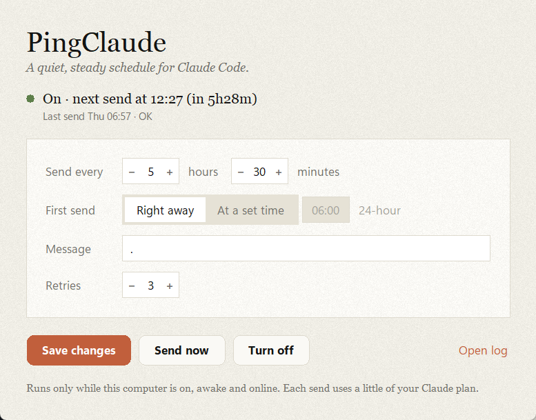

# pingclaude

A small local tool that sends a short message (`.` by default) to Claude Code on a
fixed schedule, every **5h30m** unless you change it. It runs the official `claude`
CLI with **your own existing login**: you set it once (or press one button) and it
keeps going by itself, including after you restart your computer.

- Works on **Windows, macOS and Linux**
- **One-button setup** with a small settings window, or a full command line if you prefer
- **Customizable:** the gap between messages, the time of the first message, the message itself
- Pure **Python 3.8+ standard library**; the tray icon is an optional extra
- **No credentials touched, no servers, no telemetry**

> **Important:** pingclaude only runs while your computer is **on, awake and online**.
> It is a local program, not a cloud service. If the computer sleeps through a
> scheduled send, pingclaude sends **once** when it wakes up and continues from there.
> It never fires a burst of missed messages.

---

## Contents

- [Why](#why)
- [Requirements](#requirements)
- [Install](#install)
- [Quick start (one button)](#quick-start-one-button)
- [Let Claude install it for you](#let-claude-install-it-for-you)
- [The settings window](#the-settings-window)
- [Command line](#command-line)
- [Settings and the config file](#settings-and-the-config-file)
- [How scheduling works](#how-scheduling-works)
- [Auto-start on each OS](#auto-start-on-each-os)
- [Tray icon (optional)](#tray-icon-optional)
- [What it leaves on your computer](#what-it-leaves-on-your-computer)
- [Logs](#logs)
- [Privacy and security](#privacy-and-security)
- [Uninstall completely](#uninstall-completely)
- [Updating](#updating)
- [Troubleshooting and FAQ](#troubleshooting-and-faq)
- [Disclaimer](#disclaimer)
- [Development](#development)
- [License](#license)

---

## Why

Claude plans measure usage in time windows. Some people like their window to start
at a predictable time, for example a little before they begin work, instead of
whenever they happen to send their first message. pingclaude does that by sending a
tiny message on a schedule you choose.

## Requirements

- **Python 3.8 or newer.**
  - Windows: install from [python.org](https://www.python.org/downloads/) (tick "Add python.exe to PATH").
  - macOS: install from python.org, or Homebrew (`brew install python python-tk`).
  - Linux: usually already installed; for the window also install Tk (`sudo apt install python3-tk` on Debian/Ubuntu).
- **Claude Code** (the `claude` command), installed and **logged in once**:
  1. Install it by following Anthropic's Claude Code install guide (for example
     `npm install -g @anthropic-ai/claude-code`).
  2. Open a terminal, run `claude`, and finish the login.
  3. Check it works: `claude -p "hello"` should print a reply.
- Optional, for the tray icon only: `pystray` and `Pillow`.

## Install

Download the project. Either:

```bash
git clone https://github.com/hasanulzaydd/pingclaude
cd pingclaude
```

…or download the ZIP from GitHub and unzip it anywhere.

That's all. There's nothing to compile and nothing else to install for the core.

Optionally, install it as a package to get the `pingclaude`, `pingclaude-gui` and
`pingclaude-tray` commands on your PATH:

```bash
pip install .              # core
pip install ".[tray]"      # core + tray icon
```

> **Tip:** keep the folder where it is after you turn on auto-start. Auto-start
> remembers the folder's location; if you move it, press **Turn on** again.

## Quick start (one button)

1. Open the settings window:
   - **Windows:** double-click **`PingClaude.pyw`**
   - **macOS:** double-click **`PingClaude.command`** (the first time, right-click it,
     choose **Open**, then **Open** again, because macOS blocks unsigned scripts on first launch)
   - **Linux / any OS:** `python3 pingclaude.py gui`
2. Choose the gap and when the first message should go out.
3. Press **Turn on** and confirm.

Done. pingclaude starts in the background right away and again every time you log in.
You can close the window; it keeps running without it.



The window uses a warm, Claude-inspired look: grainy ivory paper, a clay accent and
serif type. It uses Anthropic's own typefaces (Anthropic Serif / Sans, or Tiempos /
Styrene) **only if they're already installed** on your computer. They're proprietary,
so they aren't bundled; otherwise it falls back to Source Serif, Newsreader or Georgia,
and Inter or your system's sans. It contains no Anthropic logos or trademarks.

## Let Claude install it for you

You can give Claude the link to this repo and ask it to install pingclaude. Whether
that works depends on **where** you ask, because Claude needs to run commands on
**your** computer:

| Where you ask | Works? | Why |
|---|---|---|
| **Claude Code in a terminal** (`claude`) | ✅ Yes | Runs on your computer and can run commands there. |
| **Claude desktop app → Code tab** (a local session) | ✅ Yes | Same Claude Code, running on your computer. |
| **Claude Code in VS Code / JetBrains** | ✅ Yes | Same Claude Code, inside your editor. |
| **Claude desktop app or claude.ai → normal chat** | ❌ No | Chat can't run commands on your computer. It can only explain the steps. |
| **Claude Code on the web / cloud sessions** | ❌ No | These run on a cloud machine, so pingclaude would be installed *there*, not on your computer. |

**Copy this into Claude Code:**

```text
Install pingclaude from https://github.com/hasanulzaydd/pingclaude on this computer.
Clone it into a permanent folder, follow the "Steps for Claude" section of its README,
and turn it on with a 5h30m gap and the first send right away.
```

Change the gap or add a start time (e.g. "first send at 06:00") to taste.

**What to expect:**
- Claude Code asks your permission before running commands. That's normal; read
  what it wants to run before you say yes.
- Turning on auto-start creates a startup task on your computer. Claude Code's
  safety checks may stop and ask you about this step specifically, even in auto
  mode. Approve it if that's what you want.
- If you use Claude Code, you're already logged in, so pingclaude can use that login.
- As with any code from the internet, it's good practice to look through it (or
  ask Claude to review it) before installing.

### Steps for Claude

These steps are written so an AI assistant (or a person) can follow them exactly.

1. **Check Python 3.8+:** `python --version`; on macOS/Linux use `python3`.
2. **Check Claude Code:** `claude --version`. If it's missing, stop and tell the user
   to install and log in to Claude Code first.
3. **Clone into a permanent folder** (not Downloads or a temp folder, because
   auto-start points at this folder):
   `git clone https://github.com/hasanulzaydd/pingclaude ~/pingclaude`
4. **Dry run**, which sends nothing: `python pingclaude.py --dry-run --interval 3s --count 3`.
   It should end with `Finished: 3 sends done.` and exit code 0.
5. **Confirm with the user in chat** that they want auto-start set up, repeating the gap
   and start time they asked for.
6. **Install:** `python pingclaude.py install -y --interval 5h30m`, adding
   `--start-at HH:MM` if the user gave a time. Use `-y`: without it, `install` waits for a
   typed answer, gets none, and changes nothing.
7. **Verify:** `python pingclaude.py status` should show `Running: yes` and
   `Auto-start: on`. If the first send is "right away", the log
   (`~/.pingclaude/log.txt`) shows `Sent OK` within about a minute.
8. **Tell the user:** how to change settings (`python pingclaude.py gui` or
   `python pingclaude.py config --interval …`) and how to turn it off
   (`python pingclaude.py uninstall`).

Notes for assistants: don't use the settings window (it needs mouse clicks); never use
admin rights or `sudo`, since none are needed; don't edit the user's Claude Code login or
settings.

## The settings window

| Part | What it does |
|---|---|
| **Status line** | A green dot with "On · next send at 10:11 (in 5h29m)", or a gray dot with "Off". Updates every 2 seconds. |
| **Last send** | Time of the last message and whether it worked. |
| **Send every** | The gap between messages, in hours and minutes. Use **−** / **+** or type a number (minutes step by 5). |
| **First send** | A toggle: **Right away**, or **At a set time** with an HH:MM box next to it (24-hour clock). See [start times](#start-times). |
| **Message** | The text to send. Default `.` |
| **Command** | The command that does the sending. Default `claude -p --no-session-persistence`. |
| **Retries** | How many extra attempts after a failure (60 seconds apart), 0–20. Default 3. |
| **Turn on** / **Save changes** | Saves the settings, sets up auto-start (asks first, showing exactly what it will create) and starts it. If it's already on, the button reads **Save changes**: it just saves, and the running copy uses the new settings within 30 seconds. |
| **Turn off** | Stops it and removes auto-start (asks first). Your settings are kept. |
| **Send now** | Sends one message immediately, without changing the schedule. |
| **Open log** | Opens the log file. |

## Command line

Everything the window does is also available from a terminal. Run commands from the
project folder as `python pingclaude.py …` (or `python3` on macOS/Linux), or just
`pingclaude …` if you installed it with pip.

### Commands

| Command | What it does |
|---|---|
| `pingclaude` or `pingclaude run` | Run the scheduler in this terminal. Ctrl+C stops it. |
| `pingclaude gui` | Open the settings window. |
| `pingclaude install` | Save settings and start automatically at log-in. Shows what it will create and asks first (`-y` skips the question). `--tray` auto-starts the tray icon instead of the hidden runner. |
| `pingclaude uninstall` | Remove auto-start and stop the background copy. Asks first (`-y` skips). Settings and log are kept. |
| `pingclaude status` | Whether it's running, next send, last send, auto-start on/off, where files are. |
| `pingclaude send` | Send one message right now. |
| `pingclaude stop` | Stop the running copy (auto-start stays set up for next log-in). |
| `pingclaude config` | Show the saved settings. With flags, change them (see below). |
| `pingclaude --version` | Show the version. |
| `pingclaude <command> --help` | Help for one command. |

### Flags

| Flag | Default | Used by | Meaning |
|---|---|---|---|
| `--interval` | `5h30m` | run, send, install, config | Gap between sends. Accepts `5h30m`, `90m`, `10s`, `1d`, `2h5m7s` or plain seconds like `3600`. |
| `--message` | `.` | run, send, install, config | The text to send. |
| `--start-at HH:MM` | send now | run, install, config | First send at the next occurrence of this local time. `now` clears it. |
| `--count N` | forever | run | Stop after N sends. |
| `--retries N` | `3` | run, send, install, config | Extra attempts after a failure, 60s apart (0–20). |
| `--command CMD` | `claude -p --no-session-persistence` | run, send, install, config | The command to run. The message is added as the last argument. |
| `--dry-run` | off | run | Log what would happen, but send nothing. |
| `-y`, `--yes` | off | install, uninstall | Don't ask for confirmation. |
| `--tray` | off | install | Auto-start the tray icon instead of the hidden runner. |

Flags given to `run`, `send` and `install` override the saved settings for that run;
`install` and `config` also save them.

### Examples

```bash
# Try it safely: 3 fake sends, 3 seconds apart, nothing is actually sent
python pingclaude.py --dry-run --interval 3s --count 3

# Run in this terminal with the saved settings (Ctrl+C to stop)
python pingclaude.py

# Set up auto-start: first send at 06:00, then every 5h30m
python pingclaude.py install --start-at 06:00

# Change the gap while it's running (it picks this up within 30 seconds)
python pingclaude.py config --interval 5h

# Send right away when logged in, instead of at a fixed time
python pingclaude.py config --start-at now

# Use a specific model for the pings
python pingclaude.py config --command "claude -p --no-session-persistence --model haiku"

# Check on it
python pingclaude.py status

# Turn everything off
python pingclaude.py uninstall
```

## Settings and the config file

Settings live in `~/.pingclaude/config.json` (on Windows,
`C:\Users\<you>\.pingclaude\config.json`):

```json
{
  "interval": "5h30m",
  "message": ".",
  "start_at": null,
  "retries": 3,
  "command": "claude -p --no-session-persistence"
}
```

| Key | Type | Meaning |
|---|---|---|
| `interval` | text | Gap between sends, same format as `--interval`. |
| `message` | text | What to send. Must not be empty. |
| `start_at` | `"HH:MM"` or `null` | Time of the first send, or `null` for right away. |
| `retries` | number 0–20 | Extra attempts after a failure. |
| `command` | text | The command to run; the message is appended. |

You can edit the file by hand, use the window, or use `pingclaude config`. Invalid
values are rejected with a clear message. If you break the file while pingclaude
is running, it logs the problem and keeps the old settings.

**Changes apply live.** The running copy checks the file every 30 seconds and
reschedules:
- **New start time:** the next send moves to that time.
- **New gap:** the next send becomes *last send + new gap* (or right away, if that time has already passed).
- **New message, command or retries:** used from the next send onwards.

## How scheduling works

- **Fixed slots, no drift.** The next send is always *previous slot + gap*, not
  "wait the gap after the last send finished", so a slow reply doesn't push the schedule later.
- **Short sleeps.** pingclaude never sleeps more than 30 seconds at a time. Ctrl+C
  works quickly, settings changes are noticed, and waking from sleep is detected.
- **Sleep and wake.** If one or more slots passed while the computer was asleep or
  off, it sends **once** when it wakes up and restarts the schedule from that moment.
  It logs how many slots were missed.
- **Restarts.** pingclaude remembers the last send. If it restarts (you logged out
  and in, or turned it off and on), it waits out the rest of the gap instead of
  sending again straight away.
- **Retries.** If a send fails, it tries again 60 seconds later, up to `retries`
  times. If every attempt fails, it gives up on that slot and tries at the next one.
- **Timeout.** One send may take at most 5 minutes before it counts as failed.
- **One copy only.** A lock file stops two copies running at once. A second one
  exits with: *"pingclaude is already running."*

### Start times

`--start-at` (or **At a set time** in the window) means "the first send happens at the
**next** occurrence of this time":

- Set `06:00` at 05:00 → first send today at 06:00, then 11:30, 17:00, 22:30, 04:00, …
- Set `06:00` at 09:00 → first send **tomorrow** at 06:00.

With auto-start, the start time applies each time pingclaude starts (at log-in). If
you'd rather it send as soon as you log in, choose **Right away**.

## Auto-start on each OS

`install` (or **Turn on**) always shows exactly what it will create and asks first.

| OS | What gets created | Notes |
|---|---|---|
| **Windows** | A Task Scheduler task named **PingClaude**, run at log-on for your user | No admin rights needed. Set up so it **runs on battery** and has **no time limit** (Task Scheduler's defaults would stop it on laptops and after 3 days). Uses `pythonw.exe`, so no console window. If Task Scheduler is blocked on your machine, it falls back to the per-user `Run` registry key. |
| **macOS** | A LaunchAgent: `~/Library/LaunchAgents/io.github.pingclaude.plist` | Starts at log-in. Your current `PATH` is saved into it so `claude` can be found (launchd otherwise uses a bare PATH). |
| **Linux** | A systemd user service: `~/.config/systemd/user/pingclaude.service` | Enabled and started with `systemctl --user`. Runs while you're logged in. |

**Remove it by hand** (if you ever need to; normally use **Turn off** / `uninstall`):

```bash
# Windows (Command Prompt or PowerShell)
schtasks /Delete /TN PingClaude /F
```

```bash
# macOS
launchctl bootout gui/$(id -u)/io.github.pingclaude
rm ~/Library/LaunchAgents/io.github.pingclaude.plist
```

```bash
# Linux
systemctl --user disable --now pingclaude
rm ~/.config/systemd/user/pingclaude.service
```

## Tray icon (optional)

A small clay-colored dot in the system tray / menu bar (it turns gray while paused),
with a menu:

- **Next send in HH:MM**
- **Send now**
- **Pause / Resume**
- **Settings…** (opens the settings window)
- **Open log**
- **Quit**

Install the extras and start it:

```bash
pip install pystray Pillow      # or: pip install ".[tray]"
python pingclaude_tray.py
```

To have the tray icon start at log-in instead of the hidden runner:
`python pingclaude.py install --tray`. The tray runs the same scheduler as the
command line, so only one of them runs at a time.

## What it leaves on your computer

Nothing is hidden. Here is everything pingclaude creates or causes:

| What | Where | Why |
|---|---|---|
| Settings | `~/.pingclaude/config.json` | Your choices |
| Status | `~/.pingclaude/state.json` | Last send, next send, whether it's running (read by the window and `status`) |
| Log | `~/.pingclaude/log.txt` (+ up to 2 old copies, 1 MB each) | Every send and its result |
| Lock | `~/.pingclaude/pingclaude.lock` | Stops two copies running |
| Auto-start entry | See [Auto-start on each OS](#auto-start-on-each-os) | Only while it's turned on |

**Claude Code's own history.** By default Claude Code saves a transcript of every
session in `~/.claude/projects/`, about 0.5 MB each, even for a single `.`. At four
sends a day that would add up to hundreds of MB a year and clutter your session list.
That's why pingclaude's default command adds **`--no-session-persistence`**, which
tells Claude Code not to save these sessions. If your Claude Code is too old to know
that flag, pingclaude notices, sends without it, and says so in the log.

**On Anthropic's side.** Every send is a real Claude Code request on your account
and counts toward your plan's usage like any other message. pingclaude can't and
doesn't hide that.

`PINGCLAUDE_HOME` (environment variable) moves the `~/.pingclaude` folder elsewhere if you want.

## Logs

Everything is logged with timestamps to `~/.pingclaude/log.txt`, and also to the
terminal when you run it in one. Example:

```
2026-11-12 04:41:19  pingclaude 0.1.0 started: every 5h30m, message '.'
2026-11-12 04:41:19  First send: now
2026-11-12 04:41:19  Send 1: running claude -p --no-session-persistence .
2026-11-12 04:41:28  Sent OK (reply: Your message came through as just a "." ...)
2026-11-12 04:41:28  Next send at 2026-11-12 10:11:19 (in 5h29m50s)
2026-11-12 04:41:58  Settings changed: interval='4h'
2026-11-12 04:41:58  Next send at 2026-11-12 08:41:28 (in 3h59m30s)
```

When the computer wakes up late you'll see lines like
*"Woke up late: the 10:11:19 slot was missed (plus 1 more). Sending once now…"*.

## Privacy and security

- pingclaude **never reads, stores, copies or sends credentials or tokens.** It
  only starts the official `claude` program, which handles its own login.
- It makes **no network calls of its own**: no servers, no telemetry, no update checks.
- It runs `claude` with an argument list, **never through a shell**
  (`shell=True` is not used anywhere), and from inside `~/.pingclaude` so it never
  runs inside one of your project folders.
- On Windows, if `claude` is the npm `.cmd` version, messages containing
  `& | < > ^ % ! "` are refused, because `cmd.exe` would treat them as commands.
- Auto-start runs as your normal user with normal rights. It never asks for admin.

## Uninstall completely

1. Turn it off: press **Turn off** in the window, or run `python pingclaude.py uninstall`.
2. Delete the settings and log folder: `~/.pingclaude`
   (Windows: `C:\Users\<you>\.pingclaude`).
3. If you installed it with pip: `pip uninstall pingclaude`.
4. Delete the project folder.

## Updating

```bash
git pull                 # or download the new ZIP over the old folder
```

If you installed it with pip, run `pip install .` again. If you moved the folder,
press **Turn on** again so auto-start points to the new location.

> If you set it up with an older version, your saved command may still be
> `claude -p`. To switch to the no-history default:
> `python pingclaude.py config --command "claude -p --no-session-persistence"`.

## Troubleshooting and FAQ

**Does it keep running when my computer is off or asleep?**
No. It only runs while the computer is on and awake. After waking up it sends once
and carries on.

**Do I see a terminal or chat window when it sends?**
No. When it's turned on it runs hidden. The `claude` call runs in print mode
(`-p`): it sends, receives the reply, and exits. The reply is written to the log.

**"the `claude` command was not found on your PATH"**
Install Claude Code and log in once (see [Requirements](#requirements)). If `claude`
works in your terminal but not in pingclaude, auto-start may be using an older PATH:
run **Turn on** / `install` again from a terminal where `claude` works, or set the
full path, e.g. `--command "C:\path\to\claude.exe -p --no-session-persistence"`.

**"pingclaude is already running"**
Only one copy can run. Check with `pingclaude status`, stop it with `pingclaude stop`.

**I set 06:00 but logged in at 09:00 and nothing was sent.**
That's expected: the first send is at the *next* 06:00 (tomorrow). Choose
**Right away** if you want a send at log-in. See [Start times](#start-times).

**Sends fail with "exit code 1".**
Open the log for the reason. Most often you're logged out of Claude Code: run
`claude` in a terminal and log in again.

**Windows refuses my message because of `&`, `%` or similar.**
The npm install of Claude Code on Windows is a `.cmd` file and `cmd.exe` would treat
those characters as commands. Use a plain message, or install the native `claude.exe`.

**macOS: the settings window doesn't open.**
Homebrew's Python needs Tk: `brew install python-tk`. The python.org installer
already includes it. You can always use the command line instead.

**macOS: "PingClaude.command can't be opened".**
Right-click it, choose **Open**, then **Open**. If it says it isn't executable, run
`chmod +x PingClaude.command` once.

**Linux: it stops when I log out.**
systemd user services stop at log-out. To keep it running, enable lingering:
`loginctl enable-linger $USER`.

**Can I use a cheaper or faster model for the pings?**
Yes: add `--model …` to the command, e.g.
`claude -p --no-session-persistence --model haiku`.

**Can I send something other than a dot?**
Yes: set the message in the window or with `--message "good morning"`.

**How do I know it's working?**
The window's status line, `pingclaude status`, or the log. Each successful send
logs `Sent OK` with the first line of Claude's reply.

## Disclaimer

Each send is a real Claude Code request and uses a small amount of your plan's
usage. Check Anthropic's current usage policies and terms for your plan before
automating requests. pingclaude is an independent open-source project, not
affiliated with or endorsed by Anthropic. Use it at your own risk.

## Development

### Project layout

```
pingclaude.py            core: parsing, scheduler, sending, lock, config, CLI
pingclaude_autostart.py  auto-start: Task Scheduler / LaunchAgent / systemd
pingclaude_gui.py        settings window (tkinter, grain texture drawn in code)
pingclaude_tray.py       optional tray icon (pystray + Pillow)
PingClaude.pyw           double-click launcher for Windows
PingClaude.command       double-click launcher for macOS
tests/                   pytest suite
docs/settings.png        screenshot used in this README
pyproject.toml           packaging and entry points
.gitattributes           keeps LF line endings for the macOS launcher
.github/workflows/       CI: tests on Windows, macOS and Linux
```

### Running the tests

```bash
python -m pip install pytest
python -m pytest
```

The tests use a fake clock and a fake `subprocess.run`, so they finish in seconds and
never send a real message. They cover duration and time parsing, fixed-slot
scheduling, the sleep/wake logic (no bursts), retries, dry runs, config reloading,
the single-instance lock, and the generated auto-start files for all three OSes.
Every test gets its own temporary `~/.pingclaude`, so your real settings are never touched.

CI (GitHub Actions) runs the suite on Windows, macOS and Linux with several Python
versions, plus a dry-run smoke test.

### Tweaking the look

The palette, fonts and grain live at the top of `pingclaude_gui.py`: colors such as
`PAGE`, `CARD` and `ACCENT`, the `SERIF` / `SANS` font fallback lists, and
`GRAIN_AMOUNT` (0 turns the grain off) / `GRAIN_TILE`. The window is a single canvas,
so text sits directly on the textured background.

### Contributing

Issues and pull requests are welcome. Please keep the core standard-library only,
never touch credentials, and add tests for new behavior.

## License

[MIT](LICENSE)
